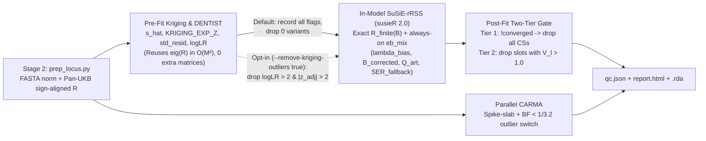

# LD-Mismatch, Kriging & Fine-Mapping Diagnostics

Summary-statistic fine-mapping pairs marginal association statistics $(z_j, N_j)$ from a study cohort with an external linkage disequilibrium (LD) correlation matrix $R$ estimated in a reference sample of size $B$ (such as Pan-UKB). Discrepancies between the study's true sample LD $R^{\text{GWAS}}$ and the reference panel $R$ arise from **finite reference sample size**, **ancestry or founder-population drift**, **uneven per-SNP sample sizes in meta-analyses**, or **upstream allele-switch / strand errors**.

**GWASfinemapping** combines **non-destructive pre-fit kriging & `DENTIST` diagnostics**, **in-model `SuSiE-rRSS` (`R_finite` + `eb_mix`) mismatch protection**, **post-fit Two-Tier credible-set gating**, and **orthogonal `CARMA` outlier Bayes factors** — while keeping destructive pre-fit kriging variant removal (`--remove-kriging-outliers`) **strictly opt-in (`false` by default)**.

---

## 1. Six Complementary Diagnostic & Protection Layers

| Layer | Where Computed | Key Statistic(s) | What It Detects / Protects Against | Modifies Variants or Model by Default? |
|---|---|---|---|---|
| **1. Null-MLE Global Mismatch (`s_hat`)** | `susie-rrss`, `multisusie` | `s_hat` $\in [0, 1]$ (`estimate_s_rss`, `"null-mle"`) | Global incompatibility between $z$ and $R$ under a null ($b=0$) model | **No** — diagnostic only (never passed as `lambda = s_hat`) |
| **2. Leave-One-Out Kriging (`logLR`)** | `susie-rrss`, `multisusie` | `KRIGING_EXP_Z`, `KRIGING_LOGLR`, `KRIGING_OUTLIER` | Single-SNP **sign reversals / allele switches** ($\log\text{LR} > 2$ and $|z_{\text{adj}}| > 2$) relative to flanking LD tags | **No** — recorded in `.rda`, `qc.json`, and `report.html` (opt-in removal via `--remove-kriging-outliers`) |
| **3. `DENTIST` Standardized Residual** | `susie-rrss`, `multisusie` | `KRIGING_STD_RESID` ($t_j$), `dentist_outlier_count` | Magnitude or sign discrepancy $t_j^2 > 29.72$ ($\chi^2_1 P < 5 \times 10^{-8}$) between $z_j$ and LD neighbours | **No** — diagnostic count only |
| **4. `SuSiE-rRSS` (`R_finite` + `eb_mix`)** | `susie-rrss` (`susieR` 2.0.0) | `lambda_bias`, `B_corrected`, `Q_art`, `SER_fallback` | Finite-$B$ noise and **post-signal** residual LD mismatch without shrinking off-diagonal LD | **Yes (in-model)** — adjusts variance & falls back to `L = 1` SER when `R_reliability_flag` triggers |
| **5. Two-Tier Credible-Set Gate** | `susie-rss`, `susie-rrss`, `polyfun`, `multisusie` | `converged`, `max_cs_prior_variance_V`, `credible_sets_suppressed` | IBSS non-convergence and collinear opposite-sign prior-variance blow-up ($V_l > 1.0$) | **Yes (post-fit)** — suppresses unconverged fits and surgically prunes $V_l > 1.0$ CS slots |
| **6. `CARMA` Spike-Slab Outlier BF** | `carma` | `OUTLIER` (`BF < 1/3.2`) | Conditional multi-SNP LD-discrepancy outliers during shotgun stochastic model search | **Yes (within `carma` only)** |

---

## 2. Mathematical Specification: `estimate_s_rss`, `kriging_rss` & `DENTIST`

### 2.1 PVE-Adjusted $Z$-Scores and Null-MLE `s_hat`

Following `susieR` (`Zou et al., 2022, PLOS Genetics`), when effective sample size $n > 2$ is available, marginal $z$-scores are first adjusted for single-SNP proportion of variance explained (PVE):

$$z_{\text{adj},j} = z_j \sqrt{\frac{n - 1}{z_j^2 + n - 2}}$$

which prevents extreme causal $z$-scores ($|z_j| \gg 10$) from exceeding $\sqrt{n - 1}$ on standardized genotypes.

Given the symmetric correlation eigendecomposition $R = V \operatorname{diag}(d) V^\top$ (with eigenvalues $d_k < 10^{-8}$ clamped to $0$) and projected scores $u = V^\top z_{\text{adj}}$, `estimate_s_rss(method = "null-mle")` minimizes the negative log-likelihood of $z_{\text{adj}} \sim \mathcal{N}(0, (1 - s)R + sI_M)$ over $s \in [0, 1]$:

$$\hat{s} = \arg\min_{s \in [0, 1]} \frac{1}{2} \sum_{k=1}^{M} \left[ \log\big((1 - s) d_k + s\big) + \frac{u_k^2}{(1 - s) d_k + s} \right].$$

### 2.2 Leave-One-Out Kriging Conditional Expectation & `DENTIST` Statistic

Setting $s_{\text{use}} = \max(\hat{s}, 0)$ (or $0.8$ if $\hat{s} > 1$) and defining the regularized precision matrix $\Omega = \big((1 - s_{\text{use}})R + s_{\text{use}} I_M\big)^{-1} = V \operatorname{diag}(d_{\text{inv}}) V^\top$ where $d_{\text{inv},k} = \big((1 - s_{\text{use}})d_k + s_{\text{use}}\big)^{-1}$, the Gaussian conditional distribution of variant $j$ given all other $M - 1$ variants $z_{\text{adj},-j}$ under the null model has closed-form precision identities:

$$\operatorname{Var}(z_{\text{adj},j} \mid z_{\text{adj},-j}) = \frac{1}{\Omega_{jj}}, \qquad \hat{\mu}_j \equiv \mathbb{E}[z_{\text{adj},j} \mid z_{\text{adj},-j}] = z_{\text{adj},j} - \frac{(\Omega z_{\text{adj}})_j}{\Omega_{jj}}$$

and standardized conditional residual:

$$t_j = \frac{z_{\text{adj},j} - \hat{\mu}_j}{\sqrt{\operatorname{Var}(z_{\text{adj},j} \mid z_{\text{adj},-j})}} = \frac{(\Omega z_{\text{adj}})_j}{\sqrt{\Omega_{jj}}}.$$

- **Connection to `DENTIST` (`Chen et al., 2021, Nature Communications`):** Squaring the standardized conditional residual yields the exact one-degree-of-freedom `DENTIST` statistic $T_{d,j} = t_j^2 \sim \chi^2_1$. Variants with $t_j^2 > 29.7168$ ($|t_j| > 5.4513$, $\chi^2_1 P < 5 \times 10^{-8}$) are counted in `diagnostics$dentist_outlier_count`.
- **`susieR` Empirical-Bayes Allele-Switch Likelihood Ratio (`KRIGING_LOGLR`):** Because causal loci exhibit heavy-tailed residuals ($|t_j| \gg 1$) even without allele flips, `kriging_rss` fits a scale-mixture normal prior $\sum_g w_g \mathcal{N}(0, a_g^2 / \Omega_{jj})$ over a geometric grid $a_g \ge 0.8$ via `mixsqp` (with an exact EM fallback) and evaluates the log-likelihood ratio comparing an **allele-flipped sign** ($z_{\text{adj},j} \approx -\hat{\mu}_j$) against the **observed sign** ($z_{\text{adj},j} \approx +\hat{\mu}_j$):
  $$\log \operatorname{LR}_j = \log \left( \sum_g w_g \, \phi\!\left(z_{\text{adj},j} + \hat{\mu}_j;\, 0, \frac{a_g^2}{\Omega_{jj}}\right) \right) - \log \left( \sum_g w_g \, \phi\!\left(z_{\text{adj},j} - \hat{\mu}_j;\, 0, \frac{a_g^2}{\Omega_{jj}}\right) \right).$$
  Following `susieR` and `MRCIEU/GeneHackman`, a variant is flagged with `KRIGING_OUTLIER = TRUE` when **`KRIGING_LOGLR > 2` and `|z_adj| > 2`** (likelihood ratio $> e^2 \approx 7.39$ in favour of a sign flip on a non-trivial association).

---

## 3. Zero-Extra-$O(M^3)$ Implementation (`src/fast_matrix.c`)

Calling `susieR::kriging_rss(z, R, n, s)` directly in high-throughput pipelines has a severe hidden memory and CPU bottleneck: even when `attr(R, "eigen")` is pre-computed, `susieR::kriging_rss` materializes the full $M \times M$ precision matrix via `precision <- V %*% (t(V) * dinv)` — performing a second $O(M^3)$ matrix-matrix multiplication, allocating **three extra $M \times M$ double matrices (`9.6 GB` RAM at $M = 20{,}000$)**, running an R `for (i in 1:M)` row-slicing loop, and constructing a `ggplot2` object.

**GWASfinemapping** eliminates all extra $O(M^3)$ work and all extra $M \times M$ allocations:

1. **Single shared eigendecomposition (`M <= 20,000`):** `run_susie_rrss()` already computes `eig <- eigen(R, symmetric = TRUE)` once (rescaling `eig$values <- eig$values / ld_scale` when `R` was scaled in place to `XtX = (n - 1)R`). That exact `eig` object is passed to `compute_kriging_from_eigen()` and then handed directly into `susieR` 2.0's `Q_art` subspace check (`precomputed_eigen = eig`).
2. **$O(M^2)$ compiled C diagonal quadratic form (`gwasfm_eigen_diag_quadform`):** Notice that only the vector $\Omega z_{\text{adj}} = V (d_{\text{inv}} \odot (V^\top z_{\text{adj}}))$ (two $O(M^2)$ BLAS `dgemv` calls) and the **diagonal** $\Omega_{jj} = \sum_{k=1}^M V_{jk}^2 d_{\text{inv},k}$ are needed. `gwasfm_eigen_diag_quadform` in `src/fast_matrix.c` accumulates $\Omega_{jj}$ in a single linear column-major sweep over `V` with **zero $M \times M$ allocations**, matching `susieR::kriging_rss` to machine precision (`< 10^-12`).
3. **Large-locus guard (`M > 20,000`, e.g. extended MHC):** Above `eigen_max_variants = 20000L`, `kriging_status` is set cleanly to `"skipped_large_m"` (`s_hat = NA`), avoiding $O(M^3)$ eigendecomposition on 35,000-variant MHC windows while keeping $O(M)$ `SuSiE-rRSS` `eb_mix` active.
4. **Cohort `eigh` caching in `MultiSuSiE` (`scripts/run_multisusie.py`):** `compute_kriging_qc_numpy()` caches `(ancestry, obs_idx)` eigendecompositions so cohorts sharing an ancestry LD matrix and variant mask (e.g. `Fenland EUR` and `ARIC EUR`) factorize $R_{\text{EUR}}$ **once**, not $K$ times.

---

## 4. Why `SuSiE-rRSS` (`eb_mix`) Replaces Legacy `lambda = s_hat` Regularization

Earlier summary-statistic workflows (built for `susieR` v0.12) passed `s_hat` back into `susie_rss(..., s = s_hat)` (shrinkage LD $\tilde{R} = (1 - \hat{s})R + \hat{s}I$). **GWASfinemapping intentionally never passes `lambda = s_hat` into `susieR`**, for two mathematical reasons:

1. **Null-MLE `s_hat` is severely upward-biased by true causal signals:** Because `estimate_s_rss("null-mle")` assumes $b = 0$, any locus with strong true associations ($|Z| = 30\text{–}109$) yields a large $\hat{s}$ (`0.15–0.65`) even when the LD matrix is **100% in-sample**! Uniformly shrinking off-diagonal LD by $(1 - \hat{s})$ attenuates the correlation between the lead causal SNP and its own LD tags ($r_{12} \to (1 - \hat{s})r_{12}$), preventing conditioning from explaining away tag $Z$-scores and **spawning false-positive secondary credible sets**.
2. **In `susieR` 2.0.0, passing `lambda` disables `SuSiE-rRSS`:** Supplying `s` / `lambda` routes `susie_rss` to legacy `rss_lambda` mode, turning off exact finite-sample `R_finite(B)` debiasing and `R_mismatch = "eb_mix"`. By contrast, `SuSiE-rRSS` estimates $\lambda_{\text{bias}}$ on **post-fit residuals** (after subtracting the fitted sparse causal effects $X b$), inflates noise via `B_corrected` without distorting off-diagonal LD structure, checks residual projection onto tiny eigenvalues (`Q_art`), and automatically falls back to a safe single-effect model (`SER_fallback = TRUE`) if `R_reliability_flag` triggers.

---

## 5. When to Use `--remove-kriging-outliers` (`X`) vs Keep Default `false` (`Y`)

> [!IMPORTANT]
> **Rule of Thumb:** Always inspect the default non-destructive kriging diagnostics first (`qc.json`, `report.html` Panel 3, `kriging_cs_outlier_count`). Enable `--remove-kriging-outliers true` **only** when you have reason to suspect upstream allele-orientation / meta-analysis artifacts (`Case X`), and **keep it `false` (default)** for standardised GWAS-VCFs, multi-causal loci, founder/admixed cohorts, and **all protein `cis-pQTL` studies (`Case Y`)**.

| Criterion | **Case `X`: Enable `--remove-kriging-outliers true`** | **Case `Y`: Keep Default (`--remove-kriging-outliers false`)** |
|---|---|---|
| **Typical Study Type** | Legacy complex-trait meta-analyses, historical rsID-harmonised GWAS tables, or heterogeneous multi-cohort IVW summary stats without per-SNP `N` filtering | Standardised GRCh38 GWAS-VCFs (`GWASprocessing`), biobank single-cohort GWAS, **protein `cis-pQTLs`**, and `cis-eQTLs` / `sQTLs` |
| **Peak Signal Regime** | Modest effect sizes ($|Z| \lesssim 15$, $P \approx 10^{-8}\text{–}10^{-40}$) with 1–2 causal signals per locus | High or extreme $|Z|$ ($|Z| = 20\text{–}110$, `LP = 100–2,595`) and/or **allelic heterogeneity** (3–10 cis signals per locus) |
| **Dominant Error Source** | Unrecorded strand flips on palindromic SNPs (`A/T`, `C/G`), cohort-specific `REF`/`ALT` swaps in fixed-effect meta-analysis, or per-SNP $N_j$ drop-offs | Finite LD sample size, subtle ancestry or founder drift (`deCODE` vs UK `EUR`), untyped structural/coding variants, or opposite-sign secondary causal variants |
| **Effect of Active Removal** | Removes isolated flipped tag SNPs that would otherwise create opposite-sign phantom credible sets | **Harmful:** can delete true opposite-sign secondary causal variants (`MMP12`, `GDF15`) or poorly tagged / founder-drifted causal coding PAVs (see [Protein cis-pQTL Guide](protein-pqtl-example.md)) |
| **Recommended Action** | Re-run affected study/locus with `--remove-kriging-outliers true` after confirming red `×` outliers in `report.html` Panel 3 | Keep `--remove-kriging-outliers false`; rely on `SuSiE-rRSS` (`eb_mix`), Two-Tier $V_l \le 1.0$ gating, `CARMA`, and post-hoc `kriging_cs_outlier_count` inspection |

---

## 6. Interpreting `report.html`, `qc.json`, and R Outputs

### 6.1 Visual Diagnostics in `report.html`

In single-study `report.html` (`scripts/render_report.R`):

- **Region Summary Badges:** Each region displays `s=X.XX` (null-MLE `s_hat`), plus warning badges whenever `Krig-CS-out:N` (`kriging_cs_outlier_count > 0`, red warning: an active 95% credible set contains a kriging sign-flip outlier), `Krig-out:N` (region-wide kriging outliers outside active CSs), or `Krig-rm:N` (variants removed when `--remove-kriging-outliers true` was enabled).
- **Panel 3 (`Kriging Expected Z vs Observed Z (PVE-adj)`):** Plots model-free leave-one-out conditional expectation $\hat{\mu}_j = \text{KRIGING\_EXP\_Z}$ on the x-axis against PVE-adjusted observed $z_{\text{adj},j}$ on the y-axis, with `s_hat` in the panel header:
  - Variants consistent with reference LD cluster tightly along the diagonal $y = x$.
  - **True allele-switch errors** appear in the **anti-diagonal quadrants** ($\hat{\mu}_j \gg +2$ with $z_{\text{adj},j} \ll -2$, or vice versa) and are highlighted with **red `×` markers** (`KRIGING_OUTLIER = TRUE`).
  - **Poorly tagged causal variants** sit vertically on $x \approx 0$ ($|\hat{\mu}_j| \approx 0$, $|z_{\text{adj},j}| \gg 0$): note that `KRIGING_LOGLR` near $x \approx 0$ stays $\approx 0$ (no sign reversal), whereas `DENTIST` flags them due to $|t_j| > 5.45$.

In `MultiSuSiE` `report.html` (`scripts/run_multisusie.py`):

- Renders a dedicated **Per-Cohort LD-Mismatch & Kriging Diagnostics** table showing each cohort's `Ancestry`, `N`, `Variants`, `s_hat`, `Kriging Outliers`, `In-CS Outliers`, `DENTIST Outliers`, `Max |Std Resid|`, and `Max logLR` — making it trivial to spot a single mis-harmonised or LD-drifted cohort inside a multi-cohort group.

### 6.2 Output Schema Quick Reference

| Location | Field | Type | Meaning |
|---|---|---|---|
| `susie_rrss$variants` | `KRIGING_EXP_Z` | `numeric` | Leave-one-out conditional mean $\hat{\mu}_j = \mathbb{E}[z_{\text{adj},j} \mid z_{\text{adj},-j}]$ |
| `susie_rrss$variants` | `KRIGING_STD_RESID` | `numeric` | Standardized conditional residual $t_j$ (`t_j^2` is the $\chi^2_1$ `DENTIST` statistic) |
| `susie_rrss$variants` | `KRIGING_LOGLR` | `numeric` | Empirical-Bayes log-likelihood ratio for allele sign flip vs no flip |
| `susie_rrss$variants` | `KRIGING_OUTLIER` | `logical` | `TRUE` if `KRIGING_LOGLR > 2` and `|z_adj| > 2` |
| `susie_rrss$credible_sets` | `kriging_outlier_count` | `integer` | Number of `KRIGING_OUTLIER` variants inside that 95% credible set (triggers `ld_mismatch_warning = TRUE` if `> 0`) |
| `susie_rrss$diagnostics` | `kriging_status` | `character` | `"computed"`, `"skipped_large_m"` ($M > 20{,}000$), or `"skipped_too_few_variants"` ($M < 3$) |
| `susie_rrss$diagnostics` | `s_hat` | `numeric` | Pre-fit null-MLE mismatch parameter $\hat{s} \in [0, 1]$ |
| `susie_rrss$diagnostics` | `kriging_outlier_count` | `integer` | Total locus variants with `KRIGING_OUTLIER == TRUE` prior to any removal |
| `susie_rrss$diagnostics` | `kriging_cs_outlier_count` | `integer` | Total active 95% CS member variants with `KRIGING_OUTLIER == TRUE` |
| `susie_rrss$diagnostics` | `dentist_outlier_count` | `integer` | Total locus variants exceeding `DENTIST` genome-wide threshold ($t_j^2 > 29.72$, $P < 5 \times 10^{-8}$) |
| `susie_rrss$diagnostics` | `kriging_outlier_gwas_variant_ids` | `character` | Up to 50 GRCh38 `chr:pos:ref:alt` IDs flagged by `KRIGING_OUTLIER` |
| `multisusie$diagnostics` | `kriging_by_cohort` | `list` / JSON | Per-cohort `s_hat`, `kriging_outlier_count`, `kriging_cs_outlier_count`, `dentist_outlier_count`, `max_abs_kriging_std_resid`, `max_kriging_loglr` |
| `qc.json` | `kriging_cs_outlier_regions` | `integer` | Count of regions where at least one active 95% CS contains a `KRIGING_OUTLIER` variant (contributes to `mismatch_flagged` / `WARN_DIAGNOSTIC_FLAGS`) |
