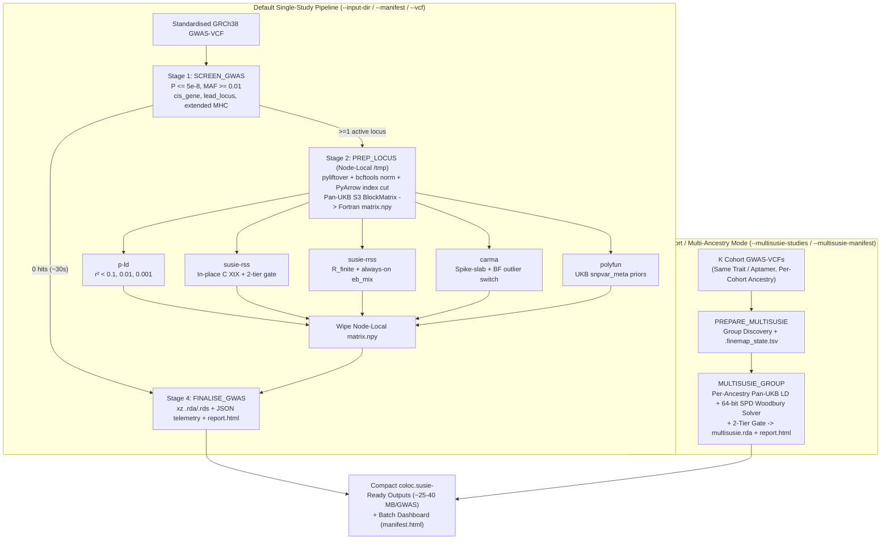

# GWASfinemapping

**GWASfinemapping** performs locus-level statistical fine-mapping, LD-based variant prioritisation, and opt-in multi-cohort / multi-ancestry joint `cis` fine-mapping (`MultiSuSiE`) on standardised GRCh38 GWAS-VCFs (specification `1.0.0`, as produced by [GWASprocessing](https://github.com/mattlee821/GWASprocessing)).

Designed for **>10,000-GWAS proteogenomic and complex-trait scale** on both macOS workstations and SLURM HPC clusters, the pipeline screens each GWAS for genome-wide significant associations ($P \le 5 \times 10^{-8}$), constructs merged 3 Mb lead windows, protein `cis_gene` windows (`gene ± 1 Mb`), and a single extended MHC region (`chr6:25.5–34.0 Mb`), lifts and left-aligns variants to GRCh37 against the six public Pan-UKB LD panels (`AFR`, `AMR`, `CSA`, `EAS`, `EUR`, `MID`), extracts each locus LD matrix once onto node-local scratch, runs up to five single-study methods in parallel, and deletes multi-gigabyte scratch matrices immediately upon locus completion.

> [!TIP]
> **Published Proteogenomic Case Study:** See the [28-Protein Cross-Platform & MultiSuSiE Study](sun_eur_vs_all_comparison_report.md) for an empirical benchmark across **8 cohort/model configurations (`216` completed fits)** comparing `UKB-PPP Sun EUR` vs `Sun ALL` (Olink), single-cohort SomaScan (`Fenland`, `deCODE`, `ARIC EUR`, `ARIC AFR`), and joint cross-ancestry **`MultiSuSiE`**.

---

## Pipeline Architecture



---

## Available Methods at a Glance

All five single-study methods run by default (`--methods "p-ld susie-rss susie-rrss carma polyfun"`). `MultiSuSiE` is strictly **opt-in** (`off` by default) via `--multisusie-studies` or `--multisusie-manifest`.

| Mode | Method ID | Statistical Model | Key Strength & Default Safeguards | `coloc.susie` `fit`? |
|---|---|---|---|---|
| **Default** | `p-ld` | Deterministic greedy LD pruning ($r^2 < 0.1, 0.01, 0.001$) | Ultra-fast heuristic lead prioritisation (`--min-maf 0.01` prevents rare zero-$r^2$ inflation) | Heuristic sets only |
| **Default** | `susie-rss` | Sum of Single Effects on summary stats (`susieR` 2.0.0) | C in-place $X^\top X$ scaling (`0` extra matrix copies), `L = 10`, purity $\ge 0.5$, 2-tier validity gate | Yes (`susie-rss.rda`) |
| **Default** | `susie-rrss` | Mismatch- & finite-sample-aware SuSiE (`susieR` 2.0.0) | Exact Pan-UKB `R_finite` + always-on `eb_mix` at all $M$, `Q_art` diagnostics, 2-tier validity gate | **Yes — Primary Recommended** |
| **Default** | `carma` | Shotgun stochastic search Spike-slab (`ZikunY/CARMA`) | C/LAPACK `dsyev` batch evaluator + Bayes-factor LD-outlier removal (`outlier.BF.index = 1/3.2`) | PIPs & CSs (`carma.rda`) |
| **Default** | `polyfun` | Functionally informed SuSiE-RSS (`Weissbrod 2020`) | 19.48M UKB `baselineLF2.2` per-SNP heritability priors (`snpvar_meta`, $q = 100$ floor) | Yes (`polyfun.rda`) |
| **Opt-in** | `multisusie` | Joint $K$-cohort / multi-ancestry SuSiE (`MultiSuSiE` 64-bit) | Per-cohort $N_k$ & ancestry-matched Pan-UKB LD, unconditionally SPD Woodbury LBF kernel + $\sigma^2 \ge 10^{-2}$ floor | **Yes (`multisusie.rda`)** |

---

## Quickstart

### 1. Install Tools & Reference Data (Once per Machine/Cluster)

```bash
git clone https://github.com/mattlee821/GWASfinemapping.git
cd GWASfinemapping

# Install conda/Python runtime, R 4.6, susieR 2.0.0, CARMA, MultiSuSiE, and gwasfinemapping
bash scripts/source.sh

# Install & checksum-verify reference genome, gene map, PolyFun priors, and 6 Pan-UKB variant indexes
bash scripts/install_reference_data.sh install
bash scripts/install_reference_data.sh check
```

### 2. Run Standard Single-Study Fine-Mapping

```bash
# Discover and fine-map all traits in a GWASprocessing study directory on SLURM
sbatch scripts/finemap.sh \
  --input-dir /path/to/GWASprocessing/GWAS/sun_2023_37794186_EUR \
  --ld-pop EUR \
  --max-forks 16 \
  --slurm
```

### 3. Run Opt-In Multi-Cohort / Multi-Ancestry `MultiSuSiE`

```bash
# Jointly fine-map shared cis_gene aptamers across UK EUR, US EUR, and US AFR cohorts
sbatch scripts/finemap.sh \
  --multisusie-studies /path/to/pietzner_2021_34648354,/path/to/zhang_2022_35501419_EUR,/path/to/zhang_2022_35501419_AFR \
  --group-study-id somascan_multisusie_3cohort \
  --cis-significance-lp 0 \
  --max-forks 8 \
  --slurm
```

---

## Documentation Map

- **[Getting Started](getting-started.md):** Prerequisites, `.env` storage paths, local vs Apptainer/Docker installation, parallel SLURM reference data builds, test suite, and benchmarks.
- **[Running Analyses & MultiSuSiE](running-analyses.md):** Complete CLI reference for single-VCF, `GWASprocessing` tree discovery, TSV manifests, opt-in `MultiSuSiE` workflows, SLURM scaling, and idempotent reruns.
- **[Outputs, Coloc & Interactive R](outputs-and-coloc.md):** Output file schemas, loading `.rda`/`.rds` containers in R, running `coloc::coloc.susie()` and `compare_pqtl_studies.R`, and interactive locus debugging in RStudio/Positron.
- **[Statistical Methods & QC](methods.md):** Windowing rules, pericentromeric & WGS `_random` contig liftover guards, Pan-UKB LD orientation, two-tier `V <= 1.0` gating, `eb_mix`, `CARMA`, `PolyFun`, and the 64-bit SPD Woodbury `MultiSuSiE` solver.
- **[28-Protein Cross-Platform & MultiSuSiE Study](sun_eur_vs_all_comparison_report.md):** Empirical results and visual comparisons for `Sun EUR` vs `Sun ALL`, SomaScan single cohorts, single-cohort vs `MultiSuSiE`, and Olink vs SomaScan across 28 CRC target proteins.
