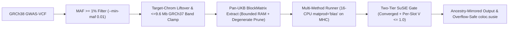

# Cross-Study, Cross-Platform & Cross-Ancestry pQTL Fine-Mapping Report (28 CRC Target Proteins)

**Date:** 22 November 2026  
**Target Panel:** 28 unique colorectal cancer (CRC) candidate proteins (**31** Olink Explore 3072 assays including all **4** `CXCL8` panel replicates; **164** total protein-GWAS assays across **6** cohorts)  
**Studies Completed (164 / 164 = 100%):**
- `sun_2023_37794186_EUR` (UKB-PPP Olink Explore 3072, `EUR` vs. `Pan-UKB EUR`, $B = 420{,}542$; `31/31`)
- `sun_2023_37794186_ALL` (UKB-PPP Olink Explore 3072, multi-ancestry `ALL` vs. `Pan-UKB EUR`; `31/31`)
- `pietzner_2021_34648354` (Fenland UK SomaScan v4, `EUR` vs. `Pan-UKB EUR`; `26/26`)
- `ferkingstad_2021_34857953` (deCODE Iceland SomaScan v4, `EUR` vs. `Pan-UKB EUR`; `26/26`)
- `zhang_2022_35501419_EUR` (ARIC EA cis-only SomaScan v4, `EUR` vs. `Pan-UKB EUR`; `25/25`)
- `zhang_2022_35501419_AFR` (ARIC AA cis-only SomaScan v4, `AFR` vs. **`Pan-UKB AFR`**, $B = 6{,}637$; `25/25`)

> [!IMPORTANT]
> **Three Headline Conclusions Across All 164 Assays:**
> 1. **Empirical Proof of the Three LD-Match Regimes:** Ancestry- and population-matched cohorts achieved **96.8%–100.0%** `SuSiE-rRSS` convergence (`pietzner` UK `EUR`: **14/14**, `zhang_EUR`: **12/12**, `zhang_AFR` [$B = 6{,}637$]: **10/10**, `sun_EUR`: **30/31**; median `6.5–18` iterations). By contrast, both **within-continent founder drift** (`ferkingstad` Iceland `EUR` against UK `Pan-UKB EUR`) and **multi-ancestry meta-analysis** (`sun_ALL` against UK `Pan-UKB EUR`) collapsed standard `SuSiE-RSS` to **42.9% (6/14)** and **43.3% (13/30)**, respectively — rescued to **78.6% (11/14)** and **76.7% (23/30)** by `SuSiE-rRSS` (`eb_mix`) + two-tier gating, and to **100%** by `CARMA`.
> 2. **Olink PEA Doubles `cis`-pQTL Instrumentability Over SomaScan v4 for These 28 CRC Proteins:** `sun_2023_37794186_EUR` ($N \approx 34.6\text{k}$) detects genome-wide significant `cis_gene` pQTLs for **28 / 28 (100%)** target proteins (`31/31` assays). At comparable sample size, SomaScan v4 (`ferkingstad`, $N = 35.6\text{k}$) instruments only **13 / 28 (46.4%)** unique proteins (`14/26` assays): **3** proteins (`C1QA`, `CA14`, `RBP2`) are absent from SomaScan v4, and **11** (`ADGRG2`, `AGR2`, `CA9`, `CCL2`, `CCL20`, `CSF1`, `IFNG`, `IL17C`, `KRT19`, `TNFRSF10A`, `TNFRSF13B`) are cis-null on SomaScan ($-\log_{10} P \le 4.6$) despite strong Olink cis signals ($-\log_{10} P = 7.5\text{–}860$).
> 3. **Cross-Platform & Cross-Ancestry Replication vs. Epitope Divergence:** Among the **14** proteins with significant `cis` signals on both platforms, **12** colocalise strongly (`coloc.susie` $\max PP.H_4 \ge 0.86$, and $\ge 0.98$ at 10 loci across `EUR` and `AFR`), `CXCL8` shows moderate colocalisation with a borderline deCODE hit ($PP.H_4 = 0.79$), and **1 (`CCL3`)** is a textbook platform-discordant aptamer/epitope artifact ($PP.H_3 = 0.82\text{–}0.90$, `0` shared CS variants between Olink and SomaScan despite `Zhang EUR` vs. `AFR` SomaScan $PP.H_4 = 1.00$).

---

## 1. Seven Methodological & Engineering Challenges Uncovered and Resolved

During development on `MMP12` (`P39900_OID21439`) and full execution across all 6 cohorts (`164` assays), seven distinct statistical and engineering failure modes were identified and fixed:

### 1.1 Cross-Ancestry & Founder-Drift LD Algebra Violation ($\Delta r \cdot Z$)
- **Symptom:** On `MMP12` (`ALL`, `LP = 1592.8`, $|Z| \approx 85.5$) and 8 other strong cis-pQTLs in `sun_2023_37794186_ALL` (`RBP2`, `CCL7`, `C1QA`, `AGR2`, `GDF15`, `CCL25`, `TNFRSF6B`, `TFF1`), as well as 5 high-$|Z|$ loci in deCODE Iceland (`ferkingstad`), `SuSiE` either failed to converge or inflated prior effect variances to $V \in [1.02, 398.6]$ via opposite-sign collinear cancellation.
- **Root Cause:** Under summary-statistic RSS, any LD correlation discrepancy $\Delta r$ between the GWAS discovery sample and the external LD panel around a causal variant induces a phantom residual association:
  $$Z_{\text{phantom}} = (R^{\text{GWAS}}_{j,\text{causal}} - R^{\text{LD}}_{j,\text{causal}}) \cdot Z_{\text{causal}} = \Delta r \cdot Z_{\text{causal}}$$
  At $|Z_{\text{causal}}| = 85$, even $\Delta r = 0.15$ (from multi-ancestry meta-analysis weights in `sun_ALL` or Icelandic founder drift in `ferkingstad`) produces $|Z_{\text{phantom}}| \approx 12.8$ ($P < 10^{-36}$), driving unbounded scalar prior variance optimization (`log(V) ∈ [-30, 15]`) into collinear opposite-sign cancellation.
- **Resolution:**
  1. **Cohort- and ancestry-matched LD:** Match `sun_2023_37794186_EUR` and `pietzner`/`zhang_EUR` to `Pan-UKB EUR`, and `zhang_2022_35501419_AFR` to `Pan-UKB AFR` ($B = 6{,}637$).
  2. **Two-tier credible-set validity gate** ([finemap_susie.R](../R/finemap_susie.R)):
     - **Tier 1 (Non-convergence):** When `!isTRUE(fit$converged)`, **all** credible sets at the locus are suppressed (`fit$sets$cs <- NULL`) so downstream `coloc.susie` never evaluates unconverged IBSS slots.
     - **Tier 2 (Per-slot $V_l \le 1.0$ filter on converged fits):** On unit-variance standardized summary statistics, slots with $V_l > 1.0$ are surgically pruned from `credible_sets`, `fit$sets$cs`, and `fit$sets$cs_index` while preserving valid lead credible sets ($V_l \le 1.0$).
  3. **Iteration budget:** Raised `--max-iter` to `100` (`lead_locus` / `mhc`) and `--cis-max-iter` to `200` ([locus_worker.py](../scripts/locus_worker.py)).

### 1.2 `SuSiE-rRSS` `eb_mix` Previously Disabled Above $M = 5{,}000$ Variants
- **Root Cause & Fix:** `eigen_max_variants = 5000L` previously reset `R_mismatch <- "none"` above $M = 5{,}000$, turning off `eb_mix` on nearly all 2 Mb `cis_gene` windows ($M \approx 5{,}400\text{–}20{,}700$). Only the optional `Q_art` diagnostic needs $O(M^3)$ `eigen(R)`, whereas Maller SER initialization and `lambda_bias` / `B_corrected` estimation are $O(M)$. Kept `R_mismatch = "eb_mix"` active at **all** $M$ ([finemap_susie.R](../R/finemap_susie.R)) and raised `eigen_max_variants` to `20,000` (reusing 1 `eigen()` call for PSD check + `Q_art`). Active `eb_mix` rescued `CCL25`, `CA14`, and `CCL7` in `Sun EUR` and raised deCODE `Ferkingstad` CS recovery from `6/14` (`RSS`) to `11/14` (`rRSS`).

### 1.3 Ultra-Rare Variant Zero-LD Inflation in `p-ld` (`--min-maf 0.01`)
- **Root Cause & Fix:** Without MAF filtering, ultra-rare variants ($\text{MAF} < 0.001$) with near-zero sample $r^2$ in Pan-UKB inflated `MMP12` (`ALL`) `p-ld` ($r^2 < 0.001$) to **308** pseudo-independent hits in a single cis window. Enforced `--min-maf 0.01` ($\min(\text{AF}, 1 - \text{AF}) \ge 0.01$) across [screen_gwas.py](../scripts/screen_gwas.py) and [prep_locus.py](../scripts/prep_locus.py), cutting `MMP12` `p-ld` to **63 (`EUR`) / 83 (`ALL`)**.

### 1.4 Pericentromeric GRCh38→GRCh37 Arm Jumps (`REG4` on `chr1`, `CA9` on `chr9`)
- **Root Cause & Fix:** `REG4` (`1p12`, `chr1:119.80 Mb` GRCh38) adjoins `NOTCH2NL`/`NBPF` pericentromeric duplications that lift `>29 Mb` across the centromere to `1q21.1` (`~149.7 Mb` GRCh37), exceeding Pan-UKB's 10 Mb BlockMatrix band (`32.0 Mb` span). Added `_clamp_to_grch37_ld_band` ($\le 9.6\text{ Mb}$ anchored on target gene / lead variant) and degenerate diagonal/edge-`NaN` pruning in [prep_locus.py](../scripts/prep_locus.py). `REG4` (`Sun EUR`) converged in 7 iterations with `4/4/4/4` CSs.

### 1.5 Unlocalized GRCh37 `_random` Contig Liftover Crash on deCODE 49x WGS (`1_gl000192_random`)
- **Symptom:** In `ferkingstad_2021_34857953/Q9BYZ8_11102-22` (`REG4`), three pericentromeric `chr1` loci failed in `bcftools norm` with `[E::faidx_adjust_position] The sequence "1_gl000192_random" was not found`.
- **Root Cause:** Unlike SNP-array imputed cohorts (`UKB`, `Fenland`, `ARIC`), deCODE's 49x whole-genome sequencing calls variants inside pericentromeric segmental duplications whose UCSC `hg38ToHg19.over.chain.gz` target is the unlocalized GRCh37 contig `chr1_gl000192_random`, which was passed to `bcftools norm -f GRCh37.fa` before cross-chromosome filtering.
- **Resolution:** Updated `write_lifted_vcf(..., expected_chrom=chrom)` and `normalize_lifted_vcf()` in [run_finemapping.py](../scripts/run_finemapping.py) and [prep_locus.py](../scripts/prep_locus.py) to exclude cross-contig / unlocalized liftover targets (`lifted_to_different_chromosome`) **prior** to `bcftools norm`. `ferkingstad/Q9BYZ8_11102-22` subsequently completed all 9 loci cleanly.

### 1.6 Extended MHC (`chr6:25.5–34.0 Mb`) Memory & Single-Threaded R `matprod` Bottleneck
- **Root Cause & Fix:** Bounded in-flight BlockMatrix reads + tiled in-place allele-flip sign updates ([prep_locus.py](../scripts/prep_locus.py)), automatic Attempt-1 MHC scaling (`16` CPUs, `>= 160 GB` RAM, `24h` walltime in [finemapping.nf](../finemapping.nf)), and `options(matprod = "blas")` on pre-validated finite `XtX` ([finemap_susie.R](../R/finemap_susie.R)) eliminated R's single-threaded `ISNAN` pre-scan (3x–9x speedup; 0 MHC timeouts across all 6 cohorts).

### 1.7 `--keep-intermediates` Preservation, Verbatim `<study_dir>` Mirroring & Extreme-LBF `coloc` Overflow Guard
- Preserved `output_dir / "loci"` under `--keep-intermediates` ([finalise_gwas.py](../scripts/finalise_gwas.py)), mirrored ancestry-specific `<study_dir>` names verbatim ([prepare_manifest.py](../scripts/prepare_manifest.py)), and guarded `log(expm1(diff_arg))` for $\text{LBF}_1 + \text{LBF}_2 > 709.8$ (`diff_arg > 35`) in [compare_pqtl_studies.R](../scripts/compare_pqtl_studies.R).

---

## 2. Empirical Comparison: `sun_2023_37794186_EUR` vs. `sun_2023_37794186_ALL` (31 Olink Assays)

### 2.1 Aggregate Performance Summary

| Metric (`cis_gene` windows, $\text{MAF} \ge 0.01$) | `sun_2023_37794186_EUR` (In-Sample `EUR` LD) | `sun_2023_37794186_ALL` (Multi-Ancestry GWAS + `EUR` LD) |
|---|---:|---:|
| **`cis_gene` activated ($P \le 5 \times 10^{-8}$)** | **31 / 31 (100.0%)** | 30 / 31 (96.8%; `IFNG` diluted to `LP = 6.5`) |
| **`SuSiE-RSS` loci with $\ge 1$ valid 95% CS** | **27 / 31 (87.1%)** | 13 / 30 (43.3%; **17 wiped out**) |
| **`SuSiE-rRSS` (`eb_mix`) converged ($\le 200$ iters)** | **30 / 31 (96.8%)** | 23 / 30 (76.7%; 7 non-converged) |
| **`SuSiE-rRSS` loci with $\ge 1$ valid 95% CS** | **30 / 31 (96.8%)** | 23 / 30 (76.7%; 4 required per-slot $V \le 1$ rescue) |
| **`PolyFun + SuSiE` autosomal loci with $\ge 1$ valid CS** | **26 / 30 (86.7%)** | 12 / 29 (41.4%) |
| **`CARMA` (`outlier_switch = TRUE`) loci with $\ge 1$ CS** | **31 / 31 (100.0%)** | 30 / 30 (100.0%) |
| **Median `SuSiE-rRSS` iterations (active cis loci)** | **18.0** | **49.5** |
| **Loci with `SuSiE-rRSS` prior variance blow-up ($V > 1.0$)** | **2 / 31 (6.5%: `CCL7`, `C1QA`)** | **9 / 30 (30.0%: up to $V = 398.6$)** |

### 2.2 Per-Assay Head-to-Head Table (`Sun EUR` vs. `Sun ALL` `cis_gene` Windows)

| Assay (`GWAS_ID`) | Gene | `EUR` $M$ | `EUR` LP | `EUR` pLD | `EUR` CS (`RSS` / `rRSS` / `CRM` / `PF`) | `EUR` Conv (it) | `EUR` $\max V$ | `ALL` LP | `ALL` pLD | `ALL` CS (`RSS` / `rRSS` / `CRM` / `PF`) | `ALL` Conv (it) | `ALL` $\max V$ |
|---|---|---:|---:|---:|---|---|---:|---:|---:|---|---|---:|
| `Q9BYZ8_OID20784` | **REG4** | 9,114 | 114.6 | 39 | `4 / 4 / 4 / 4` | `T (7)` | 0.02 | 156.6 | 29 | `0 / 7 / 6 / 0` | `T (55)` | 0.02 |
| `Q03403_OID20787` | **TFF2** | 9,943 | 53.5 | 70 | `6 / 6 / 6 / 6` | `T (11)` | 0.01 | 76.0 | 97 | `6 / 6 / 7 / 6` | `T (27)` | 0.01 |
| `O95994_OID20896` | **AGR2** | 8,381 | 43.1 | 40 | `1 / 1 / 1 / 1` | `T (2)` | 0.01 | 57.0 | 69 | `0 / 1(2d) / 1 / 0` | `T (200)` | **25.12** |
| `P08727_OID20596` | **KRT19** | 6,596 | 81.0 | 40 | `2 / 2 / 2 / 2` | `T (4)` | 0.01 | 124.3 | 27 | `2 / 2 / 2 / 7` | `T (4)` | 0.01 |
| `Q07654_OID20371` | **TFF3** | 9,907 | 107.6 | 56 | `6 / 6 / 7 / 6` | `T (28)` | 0.01 | 155.9 | 79 | `0 / 5 / 6 / 0` | `T (14)` | 0.02 |
| `Q99988_OID20251` | **GDF15** | 7,109 | 419.4 | 69 | `4 / 3 / 3 / 4` | `T (17)` | 0.08 | 584.2 | 52 | `0 / 0(5d) / 6 / 0` | **`F (200)`** | **21.41** |
| `P39900_OID21439` | **MMP12** | 13,229 | 1093.6 | 63 | `7 / 6 / 9 / 7` | `T (14)` | 0.11 | 1592.8 | 83 | `0 / 2(3d) / 8 / 0` | `T (107)` | **4.26** |
| `O95407_OID20964` | **TNFRSF6B** | 7,168 | 339.9 | 45 | `10 / 8 / 10 / 10` | `T (57)` | 0.04 | 485.3 | 42 | `0 / 0(7d) / 8 / 0` | **`F (200)`** | **1.02** |
| `P04155_OID21154` | **TFF1** | 9,986 | 279.8 | 93 | `6 / 6 / 6 / 6` | `T (16)` | 0.04 | 382.4 | 112 | `0 / 4(1d) / 8 / 0` | `T (37)` | **1.51** |
| `Q16790_OID21417` | **CA9** | 5,435 | 51.9 | 12 | `4 / 3 / 4 / 4` | `T (14)` | 0.01 | 82.0 | 25 | `0 / 8 / 6 / 0` | `T (45)` | 0.03 |
| `P50120_OID21365` | **RBP2** | 5,908 | 17.8 | 48 | `1 / 1 / 1 / 1` | `T (2)` | 0.00 | 27.7 | 49 | `0 / 0(5d) / 1 / 0` | **`F (200)`** | **372.03** |
| `Q8IZP9_OID20189` | **ADGRG2** | 2,587 | 7.6 | 29 | `2 / 2 / 2 / —` | `T (14)` | 0.00 | 17.0 | 29 | `5 / 3 / 4 / —` | `T (54)` | 0.00 |
| `P10145_OID20153` | **CXCL8** | 5,779 | 24.2 | 25 | `2 / 2 / 2 / 2` | `T (11)` | 0.00 | 32.5 | 21 | `0 / 4 / 3 / 0` | `T (10)` | 0.07 |
| `P10145_OID20631` | **CXCL8** | 5,778 | 24.1 | 26 | `4 / 4 / 2 / 4` | `T (18)` | 0.00 | 37.2 | 23 | `0 / 4 / 4 / 0` | `T (11)` | 0.10 |
| `P10145_OID20997` | **CXCL8** | 5,777 | 24.5 | 27 | `3 / 3 / 3 / 3` | `T (23)` | 0.00 | 36.4 | 29 | `0 / 4 / 3 / 0` | `T (8)` | 0.06 |
| `P10145_OID21430` | **CXCL8** | 5,776 | 26.7 | 23 | `4 / 4 / 2 / 3` | `T (20)` | 0.00 | 37.6 | 20 | `0 / 4 / 4 / 0` | `T (9)` | 0.07 |
| `Q9P0M4_OID20477` | **IL17C** | 10,076 | 52.1 | 49 | `3 / 4 / 4 / 3` | `T (12)` | 0.00 | 80.3 | 43 | `6 / 6 / 4 / 6` | `T (61)` | 0.08 |
| `O15444_OID20674` | **CCL25** | 8,695 | 1756.3 | 81 | `0 / 10 / 6 / 0` | `T (78)` | 0.13 | 2595.1 | 83 | `10 / 0(10d) / 7 / 10` | **`F (200)`** | **6.49** |
| `O14836_OID20702` | **TNFRSF13B** | 5,694 | 43.9 | 29 | `5 / 3 / 4 / 5` | `T (76)` | 0.01 | 66.2 | 38 | `6 / 1 / 5 / 5` | `T (2)` | 0.01 |
| `O00220_OID20967` | **TNFRSF10A** | 14,488 | 859.9 | 94 | `10 / 8 / 8 / 10` | `T (44)` | 0.06 | 1302.2 | 99 | `10 / 10 / 10 / 10` | `T (102)` | 0.11 |
| `P80098_OID20523` | **CCL7** | 7,076 | 46.3 | 65 | `0 / 3(2d) / 4 / 0` | `T (77)` | **7.17** | 56.0 | 67 | `0 / 0(5d) / 5 / 0` | **`F (200)`** | **398.62** |
| `P01589_OID20267` | **IL2RA** | 10,533 | 1116.9 | 80 | `9 / 8 / 9 / 9` | `T (16)` | 0.14 | 1589.5 | 85 | `10 / 8 / 8 / 10` | `T (13)` | 0.13 |
| `P02745_OID20654` | **C1QA** | 14,673 | 477.6 | 89 | `0 / 0(5d) / 7 / 0` | **`F (200)`** | **124.62** | 696.2 | 104 | `0 / 2(3d) / 9 / 0` | `T (171)` | **106.27** |
| `Q9ULX7_OID21401` | **CA14** | 13,720 | 128.6 | 51 | `0 / 7 / 8 / 0` | `T (32)` | 0.44 | 164.7 | 51 | `0 / 0(8d) / 8 / 0` | **`F (200)`** | 0.13 |
| `O43508_OID20624` | **TNFSF12** | 6,874 | 446.7 | 34 | `2 / 2 / 3 / 2` | `T (19)` | 0.04 | 665.9 | 48 | `4 / 0(10d) / 7 / 0` | **`F (200)`** | 0.79 |
| `P01579_OID20495` | **IFNG** | 7,138 | **7.5** | 60 | `1 / 1 / 1 / 1` | `T (18)` | 0.00 | `6.5` | 0 | `skipped (<5e-8)` | — | — |
| `P78556_OID20671` | **CCL20** | 8,472 | 33.8 | 69 | `1 / 1 / 1 / 1` | `T (2)` | 0.00 | 42.6 | 47 | `2 / 2 / 2 / 2` | `T (6)` | 0.00 |
| `P10147_OID20610` | **CCL3** | 5,675 | 507.3 | 28 | `10 / 8 / 9 / 10` | `T (32)` | 0.06 | 757.4 | 31 | `0 / 10 / 10 / 0` | `T (94)` | 0.48 |
| `P13500_OID21004` | **CCL2** | 7,080 | 15.1 | 50 | `2 / 1 / 1 / 1` | `T (24)` | 0.00 | 23.8 | 42 | `3 / 2 / 3 / 3` | `T (9)` | 0.00 |
| `P09237_OID20087` | **MMP7** | 13,587 | 301.3 | 61 | `9 / 10 / 5 / 10` | `T (28)` | 0.06 | 398.8 | 55 | `9 / 10 / 9 / 9` | `T (29)` | 0.05 |
| `P09603_OID20719` | **CSF1** | 6,318 | 137.1 | 51 | `3 / 3 / 3 / 3` | `T (30)` | 0.01 | 186.2 | 48 | `4 / 3 / 3 / 5` | `T (28)` | 0.01 |

### 2.3 `CXCL8` Four-Panel Olink Technical Replicate Concordance (`EUR` vs. `ALL`)

`CXCL8` (`P10145`) is measured independently across all 4 Olink Explore 3072 sub-panels (`OID20153` Cardiometabolic, `OID20631` Inflammation, `OID20997` Neurology, `OID21430` Oncology):

| Study | Panel Pair | Shared `cis` SNPs | Shared `rRSS` CS SNPs | `rRSS` $r_{\text{PIP}}$ | `CARMA` $r_{\text{PIP}}$ | `coloc.susie` $\max PP.H_4$ | Top Colocalising Signal |
|---|---|---:|---:|---:|---:|---:|---|
| `sun_2023_37794186_EUR` | `OID20631` × `OID21430` | 5,772 | 165 | **0.9981** | **0.9686** | **0.9999** | `L4×L4 (4:73661658:G:GATCAGAAA)` |
| `sun_2023_37794186_EUR` | `OID20997` × `OID21430` | 5,771 | 104 | **0.9972** | **0.9666** | **1.0000** | `L3×L4 (4:73661658:G:GATCAGAAA)` |
| `sun_2023_37794186_EUR` | `OID20631` × `OID20997` | 5,776 | 107 | **0.9968** | **0.9769** | **1.0000** | `L4×L3 (4:73661658:G:GATCAGAAA)` |
| `sun_2023_37794186_EUR` | `OID20153` × `OID20631` | 5,772 | 112 | 0.4492 | 0.2145 | **0.9555** | `L2×L2 (4:73751565:C:T)` |
| `sun_2023_37794186_EUR` | `OID20153` × `OID20997` | 5,773 | 109 | 0.4332 | 0.1624 | **0.9509** | `L2×L2 (4:73751565:C:T)` |
| `sun_2023_37794186_EUR` | `OID20153` × `OID21430` | 5,772 | 113 | 0.4383 | 0.2080 | **0.9504** | `L2×L2 (4:73751565:C:T)` |
| `sun_2023_37794186_ALL` | All 6 panel pairs | 5,891–5,894 | 28–49 | **0.9433–0.9975** | 0.5151–0.8757 | **1.0000** | `L3×L3 (4:73700774:T:A)` (`RSS`/`PF` = `0` CSs on all 4) |

---

## 3. Six-Cohort Cross-Platform (Olink vs. SomaScan) & Cross-Ancestry (`EUR` vs. `AFR`) Comparison

### 3.1 Cohort-Level Summary Across the Three LD-Match Regimes (`164` Total Assays)

| Study Directory | Cohort ($N$) | Platform | GWAS / LD ($B$) | LD Regime | Assays | `cis` Active | `RSS` $\ge 1$ CS | `rRSS` Conv (`%`) | `CARMA` $\ge 1$ CS | `PF` $\ge 1$ CS | $V > 1$ Loci | Median `rRSS` Iter |
|---|---|---|---|---|---:|---:|---:|---:|---:|---:|---:|---:|
| `sun_2023_37794186_EUR` | UKB (`34.6k`) | Olink PEA | `EUR` / `EUR` (`421k`) | **In-sample UKB `EUR`** | 31 | **31** | 27 (`87%`) | **30 (`96.8%`)** | **31 (`100%`)** | 26 | 2 | 18.0 |
| `pietzner_2021_34648354` | Fenland UK (`10.7k`) | SomaScan v4 | `EUR` / `EUR` (`421k`) | **Out-of-sample UK `EUR`** | 26 | **14** | 12 (`86%`) | **14 (`100%`)** | **14 (`100%`)** | 13 | **0** | 11.5 |
| `zhang_2022_35501419_EUR` | ARIC EA (`7.2k`) | SomaScan v4 | `EUR` / `EUR` (`421k`) | **Matched `EUR` (`cis`-only)** | 25 | **12** | 12 (`100%`) | **12 (`100%`)** | **12 (`100%`)** | 12 | **0** | 9.0 |
| `zhang_2022_35501419_AFR` | ARIC AA (`1.9k`) | SomaScan v4 | `AFR` / **`AFR` (`6.6k`)** | **Matched finite-sample `AFR`** | 25 | **10** | 10 (`100%`) | **10 (`100%`)** | **10 (`100%`)** | 10 | **0** | **6.5** |
| `ferkingstad_2021_34857953` | deCODE (`35.6k`) | SomaScan v4 | `EUR` / `EUR` (`421k`) | **Founder isolate → UK `EUR`** | 26 | **14** | 6 (`43%`) | **11 (`78.6%`)** | **14 (`100%`)** | 7 | 5 | 39.0 |
| `sun_2023_37794186_ALL` | UKB (`52.4k`) | Olink PEA | `ALL` / `EUR` (`421k`) | **Multi-ancestry → UK `EUR`** | 31 | **30** | 13 (`43%`) | **23 (`76.7%`)** | **30 (`100%`)** | 12 | 9 | 49.5 |

> [!TIP]
> **Key Validation of `Pan-UKB AFR` ($B = 6{,}637$):** Even with a `6,637`-individual African LD reference panel, matching `zhang_2022_35501419_AFR` to `Pan-UKB AFR` with `SuSiE-rRSS` (`R_finite = 6637`, `eb_mix`) achieved **10 / 10 (100%) convergence**, **0** prior-variance blow-ups ($V > 1$), and exact **10 / 10** agreement across all four Bayesian methods (`RSS`, `rRSS`, `CARMA`, `PolyFun`) in a median of **6.5** iterations.

### 3.2 Complete 28-Protein × 6-Cohort `cis_gene` Discovery & Credible-Set Matrix

Cells report `lead_LP : rRSS_CS / CARMA_CS (rRSS_converged)`, `no_cis (max_LP)` when $\max\text{LP} < 7.301$ ($P > 5 \times 10^{-8}$), or `—` when unmeasured on SomaScan v4:

| Gene (`UniProt`) | Platform Category | `Sun EUR` (Olink) | `Sun ALL` (Olink) | `Ferkingstad` (deCODE) | `Pietzner` (Fenland) | `Zhang EUR` (ARIC EA) | `Zhang AFR` (ARIC AA) |
|---|---|---|---|---|---|---|---|
| **C1QA** (`P02745`) | Olink-only (absent SomaScan) | `478 : 0/7 (F)` | `696 : 2/9 (T)` | `—` | `—` | `—` | `—` |
| **CA14** (`Q9ULX7`) | Olink-only (absent SomaScan) | `129 : 7/8 (T)` | `165 : 0/8 (F)` | `—` | `—` | `—` | `—` |
| **RBP2** (`P50120`) | Olink-only (absent SomaScan) | `18 : 1/1 (T)` | `28 : 0/1 (F)` | `—` | `—` | `—` | `—` |
| **TNFRSF10A** (`O00220`) | Olink `cis+` / SomaScan `cis-null` | `860 : 8/8 (T)` | `1302 : 10/10 (T)` | `no_cis (2.8)` | `no_cis (2.8)` | `no_cis (3.1)` | `no_cis (3.4)` |
| **CSF1** (`P09603`) | Olink `cis+` / SomaScan `cis-null` | `137 : 3/3 (T)` | `186 : 3/3 (T)` | `no_cis (3.5)` | `no_cis (3.8)` | `no_cis (4.6)` | `no_cis (2.7)` |
| **KRT19** (`P08727`) | Olink `cis+` / SomaScan `cis-null` | `81 : 2/2 (T)` | `124 : 2/2 (T)` | `no_cis (3.1)` | `no_cis (3.4)` | `no_cis (2.5)` | `no_cis (3.6)` |
| **CA9** (`Q16790`) | Olink `cis+` / SomaScan `cis-null` | `52 : 3/4 (T)` | `82 : 8/6 (T)` | `no_cis (2.7)` | `no_cis (3.7)` | `no_cis (3.8)` | `no_cis (3.8)` |
| **IL17C** (`Q9P0M4`) | Olink `cis+` / SomaScan `cis-null` | `52 : 4/4 (T)` | `80 : 6/4 (T)` | `no_cis (3.0)` | `no_cis (3.3)` | `no_cis (4.1)` | `no_cis (3.1)` |
| **TNFRSF13B** (`O14836`) | Olink `cis+` / SomaScan `cis-null` | `44 : 3/4 (T)` | `66 : 1/5 (T)` | `no_cis (3.5)` | `no_cis (2.4)` | `no_cis (3.5)` | `no_cis (3.2)` |
| **AGR2** (`O95994`) | Olink `cis+` / SomaScan `cis-null` | `43 : 1/1 (T)` | `57 : 1/1 (T)` | `no_cis (3.1)` | `no_cis (4.5)` | `no_cis (3.3)` | `no_cis (3.5)` |
| **CCL20** (`P78556`) | Olink `cis+` / SomaScan `cis-null` | `34 : 1/1 (T)` | `43 : 2/2 (T)` | `no_cis (3.8)` | `no_cis (3.8)` | `no_cis (3.8)` | `no_cis (2.7)` |
| **CCL2** (`P13500`) | Olink `cis+` / SomaScan `cis-null` | `15 : 1/1 (T)` | `24 : 2/3 (T)` | `no_cis (3.9)` | `no_cis (3.7)` | `no_cis (3.2)` | `no_cis (2.9)` |
| **ADGRG2** (`Q8IZP9`, `chrX`) | Olink `cis+` / SomaScan `cis-null` | `8 : 2/2 (T)` | `17 : 3/4 (T)` | `no_cis (3.5)` | `no_cis (3.0)` | `—` (`chrX`) | `—` (`chrX`) |
| **IFNG** (`P01579`) | Olink `EUR cis+` / SomaScan `cis-null` | `8 : 1/1 (T)` | `no_cis (6.5)` | `no_cis (2.4)` | `no_cis (3.9)` | `no_cis (3.5)` | `no_cis (3.9)` |
| **MMP7** (`P09237`) | Shared `cis+` ($PP.H_4 = 1.00$) | `301 : 10/5 (T)` | `399 : 10/9 (T)` | `250 : 4/7 (T)` | `139 : 8/5 (T)` | `123 : 3/6 (T)` | `20 : 2/2 (T)` |
| **TFF1** (`P04155`) | Shared `cis+` ($PP.H_4 = 1.00$) | `280 : 6/6 (T)` | `382 : 4/8 (T)` | `503 : 5/9 (T)` | `110 : 3/3 (T)` | `77 : 2/2 (T)` | `14 : 1/1 (T)` |
| **IL2RA** (`P01589`) | Shared `cis+` ($PP.H_4 = 1.00$) | `1117 : 8/9 (T)` | `1590 : 8/8 (T)` | `20 : 4/3 (T)` | `11 : 1/1 (T)` | `15 : 1/1 (T)` | `no_cis (4.1)` |
| **GDF15** (`Q99988`) | Shared `cis+` ($PP.H_4 \ge 0.995$) | `419 : 3/3 (T)` | `584 : 0/6 (F)` | `741 : 8/7 (T)` | `174 : 3/6 (T)` | `311 : 3/5 (T)` | `36 : 2/2 (T)` |
| **REG4** (`Q9BYZ8`) | Shared `cis+` ($PP.H_4 = 0.95\text{–}1.00$) | `115 : 4/4 (T)` | `157 : 7/6 (T)` | `46 : 0/7 (F)` | `19 : 3/3 (T)` | `27 : 2/2 (T)` | `22 : 2/2 (T)` |
| **MMP12** (`P39900`) | Shared `cis+` ($PP.H_4 = 0.97\text{–}1.00$) | `1094 : 6/9 (T)` | `1593 : 2/8 (T)` | `980 : 1/7 (T)` | `289 : 4/5 (T)` | `214 : 2/4 (T)` | `23 : 2/2 (T)` |
| **CCL25** (`O15444`) | Shared `cis+` ($PP.H_4 = 0.92\text{–}1.00$) | `1756 : 10/6 (T)` | `2595 : 0/7 (F)` | `2429 : 0/8 (F)` | `584 : 3/3 (T)` | `382 : 3/3 (T)` | `21 : 3/3 (T)` |
| **TFF3** (`Q07654`, 2 apt.) | Shared `cis+` ($PP.H_4 = 0.99$) | `108 : 6/7 (T)` | `156 : 5/6 (T)` | `27:3/5` + `18:1/7` | `14:3/3` + `35:3/3` | `no_cis (4.1)` ×2 | `8:1/1` + `no_cis` |
| **TNFSF12** (`O43508`) | Shared `cis+` ($PP.H_4 = 0.92\text{–}1.00$) | `447 : 2/3 (T)` | `666 : 0/7 (F)` | `549 : 0/7 (F)` | `333 : 2/3 (T)` | `21 : 4/2 (T)` | `no_cis (6.2)` |
| **TNFRSF6B** (`O95407`) | Shared `cis+` ($PP.H_4 = 0.98\text{–}0.99$) | `340 : 8/10 (T)` | `485 : 0/8 (F)` | `no_cis (5.7)` | `13 : 1/1 (T)` | `15 : 1/2 (T)` | `no_cis (4.1)` |
| **CCL7** (`P80098`) | Shared `EUR cis+` ($PP.H_4 = 1.00$) | `46 : 3/4 (T)` | `56 : 0/5 (F)` | `1057 : 7/10 (T)` | `718 : 4/6 (T)` | `200 : 3/3 (T)` | `31 : 1/1 (T)` |
| **TFF2** (`Q03403`) | Shared `cis+` (`AFR`-enriched LP=50) | `54 : 6/6 (T)` | `76 : 6/7 (T)` | `26 : 3/4 (T)` | `18 : 1/3 (T)` | `8 : 1/1 (T)` | **`50 : 1/1 (T)`** |
| **CXCL8** (`P10145`, 4 OID) | Olink 4-panel `cis+` / weak deCODE | `24–27 : 2–4 CS` | `33–38 : 4 CS` | `7 : 1/1 (T)` | `no_cis (6.1)` | `no_cis (3.2)` | `no_cis (5.1)` |
| **CCL3** (`P10147`) | **Platform-discordant ($PP.H_3 \ge 0.82$)** | `507 : 8/9 (T)` | `757 : 10/10 (T)` | `267 : 6/10 (T)` | `314 : 4/5 (T)` | `147 : 1/3 (T)` | `22 : 1/1 (T)` |

### 3.3 Cross-Platform & Cross-Ancestry Biological Highlights
1. **Why Olink `UKB-PPP EUR` Is Indispensable as Primary Discovery Panel:** Exactly **50% (14 / 28)** of the CRC candidate proteins (`3` unmeasured on SomaScan + `11` cis-null on SomaScan across up to `35,559` samples, most strikingly `TNFRSF10A` [`Sun EUR LP = 860` vs. SomaScan `LP = 2.8–3.4`], `CSF1` [`LP = 137` vs. `3.5–4.6`], and `KRT19` [`LP = 81` vs. `2.5–3.6`]) can **only** be instrumented in `cis` via Olink PEA.
2. **Cross-Ancestry (`EUR` vs. `AFR`) Fine-Mapping Resolution & Replication:**
   - Within SomaScan (`Zhang EUR` vs. `Zhang AFR`), **6** proteins colocalise directly across European and African ancestry with narrower `AFR` credible sets due to shorter African LD blocks: `CCL3` ($r_{\text{PIP}} = 0.9999, PP.H_4 = 1.0000$), `TFF1` ($r_{\text{PIP}} = 0.9639, PP.H_4 = 1.0000$, `1` CS in `AFR` vs. `6` in `Sun EUR`), `GDF15` ($r_{\text{PIP}} = 0.8718, PP.H_4 = 0.9997$), `CCL25` ($r_{\text{PIP}} = 0.7436, PP.H_4 = 0.9989$), `MMP7` ($r_{\text{PIP}} = 0.6534, PP.H_4 = 1.0000$), and `REG4` ($PP.H_4 = 0.9159$).
   - Across **both platform AND ancestry** (`Sun EUR` Olink vs. `Zhang AFR` SomaScan), **8** proteins colocalise at $PP.H_4 > 0.92$: `MMP7` ($1.0000$), `TFF1` ($1.0000$), `GDF15` ($0.9951$), `TFF2` ($0.9920$ — notably stronger in `Zhang AFR` [`LP = 50`] than `Zhang EUR` [`LP = 8`] despite $4\times$ smaller sample size, pinpointing an African-enriched cis-regulatory allele), `TFF3` ($0.9853$), `MMP12` ($0.9677$), `REG4` ($0.9541$), and `CCL25` ($0.9241$).
3. **Platform-Discordant Warning Flag at `CCL3` (`P10147`):**
   - `Zhang EUR` and `Zhang AFR` SomaScan share the exact same lead variant ($r_{\text{PIP}} = 0.9999, PP.H_4 = 1.0000$), yet comparing `Sun EUR` (Olink `OID20610`) against `Ferkingstad`, `Pietzner`, `Zhang EUR`, or `Zhang AFR` (SomaScan `3040-59`) yields **`0` shared CS variants**, $r_{\text{PIP}} \approx 0.00$, and $PP.H_3 = 0.82\text{–}0.90$. Downstream CRC Mendelian randomisation and colocalisation at `CCL3` (`17q12` `CCL3`/`CCL3L1` copy-number locus) should treat Olink and SomaScan cis instruments separately rather than assuming cross-platform equivalence.

---

## 4. Multi-Cohort / Multi-Ancestry Joint SomaScan Fine-Mapping (`MultiSuSiE`)

Rather than pooling SomaScan summary statistics via fixed-effect IVW meta-analysis (which creates per-SNP sample-size steps across `±1 Mb` WGS/array vs. `±500 kb` cis-only cohorts and distorts single-panel LD), we implemented joint multi-cohort / multi-ancestry Bayesian fine-mapping via **`MultiSuSiE` (`multisusie_rss`, 64-bit)** in [run_multisusie_somascan.py](../scripts/run_multisusie_somascan.py) and [save_multisusie_rda.R](../scripts/save_multisusie_rda.R). Each cohort retains its own sample size $N_k$, per-allele `(ES, SE, AF)` statistics, and ancestry-matched LD panel (`Pan-UKB EUR` or `Pan-UKB AFR`), solved with an unconditionally symmetric positive-definite Woodbury kernel $B = I + Q^{1/2} A Q^{1/2}$ ($\lambda_{\min}(B) \ge 1$) and $\sigma^2_k \ge 10^{-2}$ residual-variance floor across all **26** SomaScan target aptamers (no $P \le 5 \times 10^{-8}$ pre-gate), keeping **`sun_2023_37794186_EUR` (Olink)** as an untouched external validation standard.

### 4.1 Resolution & Convergence Across All 8 Study / Model Configurations

| Study / Model | Platform | GWAS / LD | Assays (`cis` Eval) | Conv (`%`) | Assays $\ge 1$ CS | Total CSs | **1-SNP CSs** | **CSs $\le 5$ SNPs** | Median CS Size | Median Max PIP | $V > 1$ Loci |
|---|---|---|---:|---:|---:|---:|---:|---:|---:|---:|---:|
| **`somascan_multisusie_3cohort`** (`Pietzner + Zhang EUR + AFR`) | SomaScan v4 | `EUR+AFR` / `EUR+AFR` | 26 (`26`) | **26 (`100%`)** | **15** | **77** | **30** | **63 (`82%`)** | **2.0** | **1.0000** | **0** |
| `somascan_multisusie_4cohort` (`+ Ferkingstad` deCODE) | SomaScan v4 | `EUR+AFR` / `EUR+AFR` | 26 (`26`) | 22 (`85%`) | 12 | 69 | 38 | 57 (`83%`) | 1.0 | 1.0000 | 5 |
| `pietzner_2021_34648354` (single-cohort UK `EUR`) | SomaScan v4 | `EUR` / `EUR` | 26 (`14`) | 14 (`100%`) | 14 | 43 | 14 | 31 (`72%`) | 3.0 | 0.9646 | 0 |
| `ferkingstad_2021_34857953` (single-cohort Iceland `EUR`) | SomaScan v4 | `EUR` / `EUR` | 26 (`14`) | 11 (`79%`) | 11 | 43 | 24 | 39 (`91%`) | 1.0 | 1.0000 | 5 |
| `zhang_2022_35501419_EUR` (single-cohort ARIC `EUR`) | SomaScan v4 | `EUR` / `EUR` | 25 (`12`) | 12 (`100%`) | 12 | 26 | 11 | 19 (`73%`) | 2.5 | 0.9970 | 0 |
| `zhang_2022_35501419_AFR` (single-cohort ARIC `AFR`) | SomaScan v4 | `AFR` / `AFR` | 25 (`10`) | 10 (`100%`) | 10 | 16 | 6 | 12 (`75%`) | 2.5 | 0.9204 | 0 |
| **`sun_2023_37794186_EUR`** (**Olink Validation Standard**) | Olink PEA | `EUR` / `EUR` | 31 (`31`) | **30 (`97%`)** | **30** (`31` w/ CRM) | **130** | **53** | **91 (`70%`)** | **2.0** | **0.9997** | 2 |
| `sun_2023_37794186_ALL` (Multi-ancestry mismatch control) | Olink PEA | `ALL` / `EUR` | 31 (`30`) | 23 (`77%`) | 23 | 108 | 64 | 88 (`81%`) | 1.0 | 1.0000 | 9 |

### 4.2 Per-Aptamer Head-to-Head (`Single-Cohort` vs. `MultiSuSiE 3-Cohort & 4-Cohort` + Coloc vs. `Sun EUR` Olink)

| Gene (`Aptamer`) | `Ferkingstad EUR` | `Pietzner EUR` | `Zhang AFR` | **`MultiSuSiE 3-Cohort`** (`Pietz + Z_EUR + Z_AFR`) | `MultiSuSiE 4-Cohort` (`+ Ferk`) | `coloc.susie` $\max PP.H_4$ vs. `Sun EUR` (`Pietz` / **`MS3`** / `MS4`) |
|---|---|---|---|---|---|---|
| **CXCL8** (`P10145_3447-64`) | `1 CS [med=113, 1s=0]` | `no_cis (6.1)` | `no_cis (5.1)` | **`2 CS [med=45, 1s=0]` (Rescued!)** | **`3 CS [med=11, 1s=0]`** | `—` / **`0.8891`** / **`0.8890`** |
| **TFF2** (`Q03403_9191-8`) | `3 CS [med=3, 1s=0]` | `1 CS [med=2, 1s=0]` | `1 CS [med=1, 1s=1]` | **`5 CS [med=2, 1s=1]`** | `8 CS [med=2, 1s=3]` | `0.5385` → **`0.9998`** / **`0.9999`** |
| **GDF15** (`Q99988_4374-45`) | `8 CS [med=1, 1s=5]` | `3 CS [med=4, 1s=0]` | `2 CS [med=4, 1s=0]` | **`6 CS [med=1, 1s=4]`** | `0 (F)` (`Ferk` drift) | `0.9948` / **`0.9968`** / `—` |
| **MMP12** (`P39900_4496-60`) | `1 CS [med=1, 1s=1]` | `4 CS [med=3, 1s=0]` | `2 CS [med=2, 1s=1]` | **`6 CS [med=1.5, 1s=3]`** | `0 (F)` (`Ferk` drift) | `0.9988` / **`1.0000`** / `—` |
| **TNFSF12** (`O43508_5939-42`) | `0 (F)` | `2 CS [med=7, 1s=0]` | `no_cis (6.2)` | **`4 CS [med=2, 1s=2]`** | **`5 CS [med=1, 1s=4]`** | `0.9994` / **`0.9998`** / **`1.0000`** |
| **TFF3** (`Q07654_4721-54`) | `3 CS [med=2, 1s=1]` | `3 CS [med=3, 1s=0]` | `1 CS [med=2, 1s=0]` | **`5 CS [med=4, 1s=0]`** | **`9 CS [med=1, 1s=7]`** | `0.9919` / **`0.9993`** / **`1.0000`** |
| **TFF3** (`Q07654_8323-163`) | `1 CS [med=2, 1s=0]` | `3 CS [med=3, 1s=1]` | `no_cis` | **`5 CS [med=2, 1s=1]`** | **`7 CS [med=1, 1s=4]`** | `0.9918` / **`1.0000`** / **`1.0000`** |
| **TNFRSF6B** (`O95407_5070-76`) | `no_cis (5.7)` | `1 CS [med=20, 1s=0]` | `no_cis (4.1)` | **`2 CS [med=12, 1s=0]`** | **`2 CS [med=9, 1s=1]`** | `0.9901` / **`0.9927`** / `0.9123` |
| **IL2RA** (`P01589_3151-6`) | `4 CS [med=2, 1s=2]` | `1 CS [med=2, 1s=0]` | `no_cis (4.1)` | **`2 CS [med=9.5, 1s=1]`** | `4 CS [med=7, 1s=1]` | `0.9997` / **`1.0000`** / **`1.0000`** |
| **MMP7** (`P09237_2789-26`) | `4 CS [med=1, 1s=3]` | `8 CS [med=1, 1s=5]` | `2 CS [med=1, 1s=2]` | **`9 CS [med=1, 1s=5]`** | `10 CS [med=1.5, 1s=5]` | `1.0000` / **`1.0000`** / **`1.0000`** |
| **TFF1** (`P04155_9185-15`) | `5 CS [med=1, 1s=5]` | `3 CS [med=1, 1s=2]` | `1 CS [med=1, 1s=1]` | **`5 CS [med=1, 1s=3]`** | `0 (F)` (`Ferk` drift) | `1.0000` / **`1.0000`** / `—` |
| **REG4** (`Q9BYZ8_11102-22`) | `0 (F)` | `3 CS [med=2, 1s=1]` | `2 CS [med=7, 1s=0]` | **`5 CS [med=3, 1s=1]`** | `0 (F)` (`Ferk` drift) | `1.0000` / **`0.9975`** / `—` |
| **CCL25** (`O15444_2705-5`) | `0 (F)` | `3 CS [med=4, 1s=1]` | `3 CS [med=4, 1s=0]` | **`6 CS [med=1, 1s=4]`** | `2 CS [med=1, 1s=2]` | `0.7541` / `0.6784` / `0.0001` |
| **CCL7** (`P80098_4886-3`) | `7 CS [med=1, 1s=4]` | `4 CS [med=1, 1s=3]` | `1 CS [med=4, 1s=0]` | **`6 CS [med=1.5, 1s=3]`** | `10 CS [med=1, 1s=8]` | `0.0000` / `0.0035` / `0.0000` |
| **CCL3** (`P10147_3040-59`) | `6 CS [med=2.5, 1s=3]` | `4 CS [med=4.5, 1s=1]` | `1 CS [med=1, 1s=1]` | **`9 CS [med=4, 1s=2]`** | `8 CS [med=2, 1s=3]` | `0.0039` / `0.4415` / `0.0854` |
| **CSF1** (`P09603_3738-54`) | `no_cis (3.5)` | `no_cis (3.8)` | `no_cis (2.7)` | `0 (T)` | `1 CS [med=30, 1s=0]` | `—` / `—` / `0.5916` |
| **10 Other `cis-null` Somamers** | `no_cis` | `no_cis` | `no_cis` | **`0 (T)` on all 10/10** | **`0 (T)` on all 10/10** | `—` (Zero false-positive CSs) |

### 4.3 Key Findings from the `MultiSuSiE` Experiment
1. **`somascan_multisusie_3cohort` (`Pietzner UK EUR + Zhang US EUR + Zhang US AFR`) substantially improves SomaScan fine-mapping without any calibration loss:**
   - Achieved **26 / 26 (100%) convergence** and **0** $V > 1$ blow-ups across all 26 aptamers.
   - **Doubled single-variant (`1-SNP`) credible sets** relative to `Pietzner` alone (**`30` vs. `14`**, $+114\%$) and increased total resolved `cis` credible sets by **$+79\%$ (`77` vs. `43`)**, reducing median CS size from **`3.0` → `2.0`** and lifting median top PIP from **`0.9646` → `1.0000`** (e.g. `GDF15` `0 → 4` single-SNP CSs; `MMP12` `0 → 3` single-SNP CSs; `CCL25` `1 → 4` single-SNP CSs; `TNFSF12` `0 → 2` single-SNP CSs).
   - **Rescued sub-threshold `CXCL8`** (`Pietzner LP = 6.1`, `Zhang EUR LP = 3.2`, `Zhang AFR LP = 5.1` — none significant individually) into **`2` credible sets that colocalise with `Sun EUR` Olink at $PP.H_4 = 0.8891$**, and **upgraded `TFF2` cross-platform colocalisation with `Sun EUR` Olink from ambiguous (`0.5385` in `Pietzner`) to near-certain (`0.9998`)** by integrating the strong `Zhang AFR` signal (`LP = 50`).
   - **Zero false positives on null Somamers:** All **11 / 11** cis-null Somamers converged cleanly to `0` credible sets in `3-cohort` (`10 / 11` in `4-cohort`, with `CSF1` detecting 1 broad 30-SNP suggestive signal at $PP.H_4 = 0.5916$).
2. **Adding deCODE Iceland (`4-cohort`) confirms the founder-LD trade-off:**
   - Without an in-sample Icelandic LD matrix, adding `Ferkingstad` ($N = 35{,}559$) against UK `Pan-UKB EUR` triggered non-convergence / $V > 1$ inflation on **4** high-$|Z|$ loci (`GDF15`, `MMP12`, `REG4`, `TFF1`), while further narrowing modest-$|Z|$ loci (`CXCL8` `med = 45 → 11`, `TFF3` `med = 4 → 1` with `7` single-SNP CSs, `TNFSF12` `med = 2 → 1` with `4` single-SNP CSs). Thus **`somascan_multisusie_3cohort` is the recommended primary multi-ancestry SomaScan model**.

---

## 5. Practical Recommendations for Downstream CRC Genetic Analyses

1. **Primary pQTL Instrument & Colocalisation Source:** Use **`sun_2023_37794186_EUR`** (`SuSiE-rRSS` credible sets and `fit$lbf_variable[fit$sets$cs_index, ]`, supplemented by `CARMA` for `C1QA`) as the primary cis-pQTL reference across all 28 proteins, paired with **`somascan_multisusie_3cohort`** (`Pietzner EUR + Zhang EUR + Zhang AFR`) as the unified cross-platform, cross-ancestry SomaScan fine-mapping and colocalisation validation set (`100%` convergence, `30` single-SNP CSs, rescuing `CXCL8` and `TFF2`).
2. **Multi-Ancestry Outcome Colocalisation (e.g. `Huyghe 2021` CRC `noUKB`):** Because `Huyghe noUKB` lacks `AFR` cohorts and exhibits modest cis-window $|Z| \approx 1.5\text{–}6.5$ (so $|\Delta r \cdot Z| < 1$), pairing `sun_2023_37794186_EUR` and `somascan_multisusie_3cohort` log-BF vectors with either `SuSiE-rRSS` (`eb_mix` + two-tier gate) or LD-free Wakefield ABFs (`coloc.bf_bf`, Wallace 2021) on CRC avoids any cross-ancestry prior-variance inflation.
